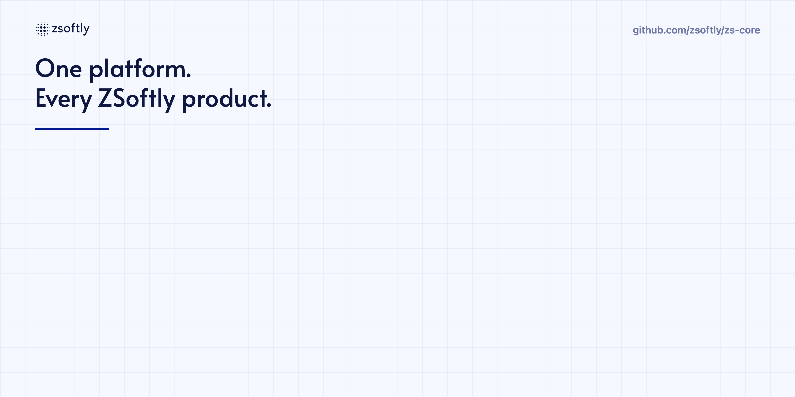

# ZSoftly Core

<picture>
  <source
    media="(prefers-reduced-motion: reduce)"
    srcset=".github/assets/poster.png">
  
</picture>

## TL;DR

ZSoftly Core (zs-core) is the open-source business platform that ZSoftly products run on. Keycloak handles identity and Kill Bill handles subscription billing. Both stay independent services. Core adds the eight capabilities that sit between them and a product: tenants, prepaid wallets, usage metering, a service catalog, payments and tax, notifications, audit, and a developer API. Each capability is a package in one Go module, importable on its own or served over one HTTP API, on one shared schema (decision 0001). The platform is headless by default, with optional admin and customer-facing UIs. Everything in this repository is licensed under Apache 2.0, and no enterprise license is needed to self-host it.

> **Early days.** ZSoftly Core is under active development. Expect some bugs and breaking changes until the first stable release.

## Guiding principle

API-first, fully extensible, self-hosted, white-label, and open-source. Every feature must be configurable or replaceable without modifying the core code.

The goal is one platform that powers every ZSoftly product, and any other business, independently. Any business should be able to deploy ZSoftly Core, apply its own branding, configure its products and billing, and start using the system without forking the repository.

## Why this exists

Every ZSoftly product needs the same things: a company with members and roles, a balance to charge against, a record of what was used, a list of what can be bought, a way to take payment and tax it correctly, a way to tell people what happened, a log of who did what, and an API that other software can call. Building those once, in the open, keeps the products consistent and lets other companies reuse the work.

## Capabilities

| Module | Scope |
| --- | --- |
| Organization and tenant management | Companies, workspaces, teams, roles, permissions, and multi-tenant isolation. |
| Prepaid wallet and credits | Balances, promotional credits, top-ups, reservations, refunds, and expiration. |
| Usage metering and pricing | VM hours, storage, CI minutes, API calls, subscriptions, and other billable usage. |
| Service catalog and entitlements | Products, plans, quotas, free trials, upgrades, downgrades, and purchase-based access. |
| Payment and tax management | Stripe, Creem, and other gateways, multiple currencies, invoices, GST/HST, VAT, and separate legal sellers. |
| Notifications and communication | Email, SMS, webhooks, low-credit alerts, payment failures, account verification, and EN/FR templates. |
| Audit and security | Activity logs, API keys, service accounts, fraud controls, MFA policies, and approvals for sensitive actions. |
| Developer platform | Unified REST APIs, SDKs, webhooks, Terraform integration, and optional MCP tools for AI agents. |

## Twelve core principles

| Principle | Requirement |
| --- | --- |
| 1. API-first | Every feature is available through a documented, versioned REST API. The UI uses the same APIs. |
| 2. Fully white-label | Each product can customize logos, favicons, colours, fonts, domains, login pages, Keycloak themes, invoices, and email templates. |
| 3. Plugin architecture | Installable plugins, custom modules, event hooks, and extensions work without modifying the core. |
| 4. Multi-tenant by design | Organizations, products, users, permissions, billing accounts, and customer data are separated with enforced isolation. |
| 5. Provider independence | Keycloak and Kill Bill are the starting engines. External services are accessed through adapters where replacement is practical. |
| 6. Configuration as code | Everything is configurable through declarative files, APIs, Terraform, or Ansible. No mandatory manual setup. |
| 7. Event-driven | Versioned events and signed webhooks are published for payments, user registration, usage, subscriptions, and account changes. |
| 8. Customizable workflows | Businesses define onboarding, account approval, billing cycles, payment reminders, and notification rules. |
| 9. Security by default | OIDC, MFA, RBAC, scoped API keys, audit logs, encryption, and strict tenant boundaries. |
| 10. Localization | Multiple languages, currencies, time zones, tax rules, and translated templates. EN and FR first. |
| 11. Modular deployment | Deploy only the components needed. No product has to run every service or extension. |
| 12. Open-source ownership | Apache 2.0, self-hostable, no license callbacks, no enterprise feature locks, documented builds. |

## Architecture

```
             ZSoftly Platform Core
                      |
                Unified APIs
                      |
         +------------+------------+
         |                         |
      Keycloak                  Kill Bill
      Identity                  Billing
         |                         |
      Themes                 Payment plugins
      SSO / MFA              Stripe / PayPal / Creem
      Users / Roles          Invoices / Subscriptions
      Email templates        Usage / Payments
         |                         |
         +------------+------------+
                      |
             ZSoftly Extensions
           Wallets / Reservations
           Metering / Entitlements
           Branding / Notifications
                      |
       Compute / Storage / Networking / DNS
     App Hosting / Kubernetes / Databases / CI
```

Stripe is verified and Adyen is pinned. PayPal waits on a Java plugin, and Creem has no Kill Bill plugin yet. A product that wants either writes one through the extension guide.

## Non-negotiable rules

1. **No hardcoded branding or business rules.** Every product defines its own Keycloak theme, email templates, sender addresses, payment providers, pricing, and invoices through configuration or plugins.
2. **Never modify upstream Keycloak or Kill Bill.** Build around their supported APIs and plugin systems so upgrades stay simple.
3. **Keep financial and identity boundaries strict.** Sharing the platform must never expose one product's customers, secrets, payments, or financial records to another product. Changing one product's invoice template or login branding must not affect another product.

## Design principles

- Keycloak and Kill Bill remain independent services. Core packages, configures, brands and upgrades them on one release cadence. It reaches them only through their public APIs and extension points, and never forks them.
- Each module is self-hosted and deployable on its own. There is no single application that owns all the data.
- Modules talk to each other through versioned APIs and events, not shared database tables.
- Tenant isolation is enforced in every module, not only at the identity layer.
- Kill Bill is the financial authority. Core extensions keep their own transactional records for reservations, metering and quotas, and never a competing customer balance or payment ledger.
- Every API is documented, and every sensitive action is auditable.

## What every feature must ship with

- API endpoints and OpenAPI documentation.
- A configuration schema with validation.
- Extension hooks where appropriate.
- Tests covering tenant isolation and permissions.
- Documentation and working examples.
- A migration and backward-compatibility strategy.

## Status

ZSoftly Core is under active development. Expect bugs, breaking changes, and gaps in the documentation until the first stable release. The foundation code and the reference stack are in this repository. The module contracts for identity, billing and the wallet extensions are drafts until their phase lands. Issues and external pull requests are closed while the module contracts settle; see [CONTRIBUTING.md](CONTRIBUTING.md) for how to reach the maintainers and when contributions open.

## Repository layout

| Path | Contents |
| --- | --- |
| `cmd/zs-core` | The service binary, with `serve`, `migrate` and the operator commands `doctor`, `upgrade`, `brand`, `grant`, `tenant`, `credit-code`, `credit`, `wallet` and `usage`. |
| `pkg/` | Importable packages: `errors`, `idgen`, `scope`, `idempotency`, `events`, `outbox`, `audit`, `brand`, `identity`, `tenant`, `apikey`, `billing`, `wallet`, `metering` and `quota`. Writers take a `pgx.Tx`, so a product can use them inside its own transaction. |
| `internal/` | Service-only code: configuration, database and migration runner, the HTTP API, the Keycloak and Kill Bill clients, and the test harnesses for Postgres, the engines and the reference stack. |
| `migrations/` | Forward-only SQL migrations, embedded in the binary. |
| `api/openapi.yaml` | The OpenAPI 3.1 contract. Go types in `internal/httpapi/gen` are generated from it. |
| `docs/` | Architecture, decisions, configuration, development and module guides. |

## Development

`make check` gates every change. No hosted CI workflow exists. Start with [docs/development.md](docs/development.md) for building, testing and migrating, and [docs/configuration.md](docs/configuration.md) for every environment variable. Module guides are in [docs/modules](docs/modules), starting with [foundation](docs/modules/foundation.md), [audit](docs/modules/audit.md), [brands](docs/modules/brands.md), [tenants](docs/modules/tenants.md), [API keys](docs/modules/api-keys.md), [billing](docs/modules/billing.md), [wallet](docs/modules/wallet.md), [metering](docs/modules/metering.md) and [quotas](docs/modules/quotas.md). Code that started in other ZSoftly repositories is listed in [PROVENANCE.md](PROVENANCE.md).

Phase 5a adds [plugin operations](docs/modules/plugins.md), [invoice rendering](docs/modules/invoices.md), and [billing surface](docs/modules/billing-surface.md) guides.

### Known Phase 5a deviations

- Tenant creation copies the creator's verified email to the Kill Bill account. Membership and ownership changes do not reconcile that recipient, so former members may continue receiving billing mail. This disclosure risk remains unresolved.
- Invoice numbers are server-wide unique and increasing, with per-tenant gaps. Owner review is pending; numbering is not gapless.
- V1 remains incomplete. Keycloak event ingestion, guide acceptance, and theme claims are not part of this candidate.

## License

Apache License 2.0. See [LICENSE](LICENSE) and [NOTICE](NOTICE).
